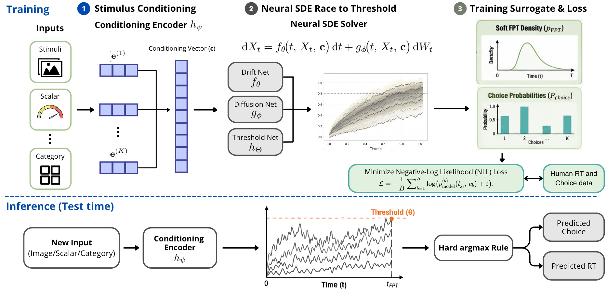
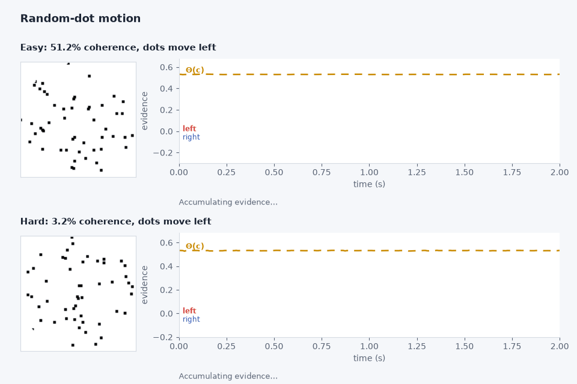
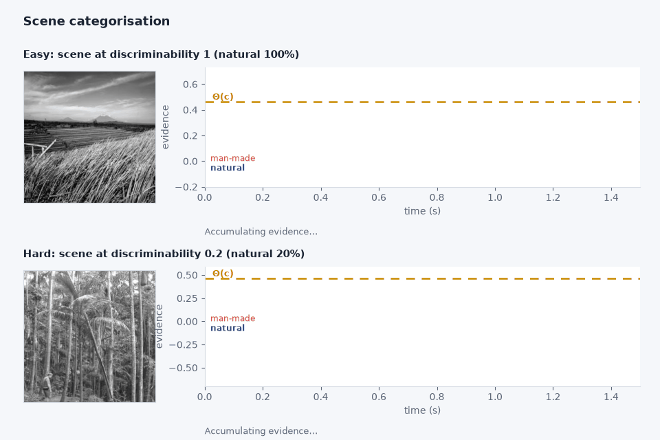
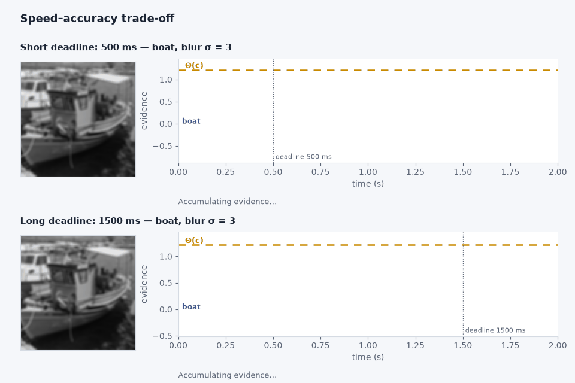

<div align="center">

# The Neural Race Model

**One accumulator per alternative, racing towards a learnable, stimulus-dependent threshold.**

[](https://neurips.cc/)
[](https://phuselab.github.io/NRM/)
[](https://www.python.org/)
[](https://docs.astral.sh/uv/)
[](LICENSE)

[**Project page**](https://phuselab.github.io/NRM/) · [**Tutorial**](tutorial/nrm_demo.ipynb) · [**Quickstart**](#quickstart) · [**Reproduce the paper**](#reproduce-the-paper) · [**Data**](#data)



</div>

---

## What it is

NRM is a **stimulus-conditional neural stochastic differential equation**. One
accumulator per alternative integrates evidence and races towards a threshold
that the model itself predicts from the stimulus:

$$dX_i = f_\theta(X_i, c)\,dt + g_\phi(X_i, c)\,dW_i, \qquad \text{choice} = \arg\min_i \inf\\{t : X_i(t) \ge \Theta_i(c)\\}$$

Drift $f_\theta$, diffusion $g_\phi$ and threshold $\Theta$ are all neural
networks conditioned on a stimulus embedding $c$, so accumulation dynamics
*and* decision urgency vary trial by trial. Replacing the hard first-passage
time with a smooth surrogate makes the whole thing differentiable, and the
model is trained end-to-end on the joint likelihood of each trial's
**(choice, reaction time)** pair — no stage-wise fitting, no hand-picked
features.

<table>
<tr><th align="left">Benchmark</th><th align="left">Task</th><th align="right">Alt.</th><th align="left">Headline metric</th><th align="left">Paper</th></tr>
<tr><td><b>RDM</b></td><td>Random-dot motion direction</td><td align="right">2</td><td>&kappa; = 0.585, r<sub>RT</sub> = 0.989</td><td>Table 2</td></tr>
<tr><td><b>SAT</b></td><td>Object recognition under deadline</td><td align="right">16</td><td>eRMSE = 24.3–30.7</td><td>Table 3</td></tr>
<tr><td><b>SC</b></td><td>Scene categorisation</td><td align="right">2</td><td>&kappa; = 0.666, AUC = 0.916</td><td>Table 1</td></tr>
</table>

NRM is first on all three, and the only model evaluated on all three.

---

## Install

Requires **Python ≥ 3.10** and [uv](https://docs.astral.sh/uv/). A CUDA GPU is
needed for training and strongly recommended for evaluation.

```bash
# 1. uv, if you don't have it
curl -LsSf https://astral.sh/uv/install.sh | sh

# 2. clone — the repo is code only, ~34 MB
git clone git@github.com:phuselab/NRM.git
cd NRM

# 3. create the environment and install everything, pinned by uv.lock
uv sync

# 4. fetch the embeddings and the behavioural data (~1.2 GB, into their canonical paths)
uv run python fetch_assets.py --all
```

Step 4 downloads the RDM and SAT stimulus embeddings (a GitHub Release of this
repository) and the three human behavioural datasets from their original
publishers. The NRM checkpoints are already in git. See [Data](#data).

`uv sync` creates `.venv/` and installs the exact locked versions. Prefix
commands with `uv run`, or activate once:

```bash
source .venv/bin/activate
```

<details>
<summary><b>Verify the install</b></summary>

```bash
uv run python fetch_assets.py --check     # are the assets in place?

uv run python -c "
from nrm.config import build_model
import torch
m = build_model('rdm', device='cpu')
m.load_state_dict(torch.load('nrm/weights/NRM_rdm.pth', map_location='cpu'))
print('NRM loaded:', sum(p.numel() for p in m.parameters()), 'parameters')"
```

</details>

<details>
<summary><b>Troubleshooting</b></summary>

| Symptom | Cause | Fix |
|---|---|---|
| `FileNotFoundError` on an embeddings or data path | Assets not fetched yet | `uv run python fetch_assets.py --all` |
| `ModuleNotFoundError: cv2` | Stale environment | `uv sync` (opencv is a declared dependency) |
| Competitor weights missing | Not distributed | Train them: see [Competitors](#competitors) |
| SAT: `none of the ... SAT stimulus images` | SAT stimulus images absent | Put ImageNet in `datasets/sat/ILSVRC/`, then `uv run python fetch_assets.py sat-images` (or `uv run --extra kaggle python fetch_assets.py sat-images --kaggle`) |
| CUDA OOM during SAT | 16 accumulators × 64 repetitions | Lower `n_reps` / `batch_size` in `nrm/config.yaml` |

</details>

---

## Quickstart

Run one trial and watch the race:

```python
import torch
from nrm.config import build_model

model = build_model("sc", device="cuda")          # "rdm" | "sat" | "sc"
model.load_state_dict(torch.load("nrm/weights/NRM_sc.pt"))
model.eval()

embedding = torch.randn(1, 18)                     # an 18-d scene embedding
xs, ts, choices, rts = model.simulate_nDDM(
    batch_size=1, covariates={"img_embedding": embedding}, n_reps=64,
)
print(f"choice {choices.item()} at {rts.item():.3f} s")
```

`xs` holds every accumulator trajectory, so you can plot the race itself —
[`tutorial/nrm_demo.ipynb`](tutorial/nrm_demo.ipynb) walks through inference
for all three benchmarks: loading the checkpoint, building the stimulus
embedding, sampling choices and RTs, `forward_pass`, and the threshold Θ(c).
Each section ends with the race for an easy and a hard trial, plotted next to
the stimulus. `python tutorial/make_gifs.py` writes the same animations to
`assets/`.

<div align="center">







</div>

<sub>SAT panel: the ImageNet stimuli cannot be redistributed, so it shows a CC0
photo of the same category from Wikimedia Commons
([boat](https://commons.wikimedia.org/wiki/File:Blue_fishing_boat_harbour_Eretria_Euboea_Greece.jpg)) with the
trial's perturbation applied; the race is the model's response to the real
trial. RDM panel: the trial's direction and coherence drawn with 60 dots instead
of the experiment's 6, for legibility. SC panel: stimuli from Sofer et al.
(2015), PLoS Comput Biol, CC BY 4.0.</sub>

For the likelihood terms the loss uses instead of a sampled decision:

```python
choice_probs, first_passage_density, ts, ndt = model.forward_pass(
    covariates={"img_embedding": embedding}, batch_size=1, n_reps=64,
)
```

---

## Inference

The pipeline notebooks evaluate the shipped checkpoints on the held-out test
split and write every table and figure (see
[Reproduce the paper](#reproduce-the-paper)).

| Benchmark | Checkpoint | Needs | Notebook |
|---|---|---|---|
| RDM | `nrm/weights/NRM_rdm.pth` | `embeddings/rdm/rdm_embeddings.pt` | `pipelines/rdm.ipynb` |
| SAT | `NRM_sat_{blur,color,noise}.pth` | `embeddings/sat/*.pt` + `datasets/sat/data/` | `pipelines/sat.ipynb` |
| SC | `nrm/weights/NRM_sc.pt` | `embeddings/sc/sc_embeddings.pt` | `pipelines/sc.ipynb` |

---

## Training

Each benchmark has one script, which retrains NRM from scratch. The paper's
hyperparameters are the defaults, in `nrm/config.py` (`BENCHMARK_DEFAULTS`);
override them in `nrm/config.yaml` without touching code.

```bash
uv run python scripts/train_nrm_rdm.py                                # RDM
uv run python scripts/train_nrm_sat.py --perturbation color-blur      # SAT
uv run python scripts/train_nrm_sc.py                                 # SC
```

SAT's three perturbation conditions are separate models — train each:

```bash
for p in color-blur color-gray gray-noise; do
  uv run python scripts/train_nrm_sat.py --perturbation $p
done
```

> The released checkpoints are never overwritten: the scripts save only the
> trained weights, next to them with a `_REFRESH` suffix
> (`nrm/weights/NRM_rdm_REFRESH.pth`, ...). `pipelines/*.ipynb` evaluate them
> with `REFRESH_WEIGHTS = True` (see [Reproduce the paper](#reproduce-the-paper)).

<table>
<tr><th align="left">Config</th><th align="right">RDM</th><th align="right">SAT</th><th align="right">SC</th></tr>
<tr><td>model class</td><td align="right"><code>TimeEmbeddedNRM</code></td><td align="right"><code>NRM</code></td><td align="right"><code>NRM</code></td></tr>
<tr><td>alternatives</td><td align="right">2</td><td align="right">16</td><td align="right">2</td></tr>
<tr><td>cond_dim</td><td align="right">32</td><td align="right">128 <sub>(64+64)</sub></td><td align="right">32</td></tr>
<tr><td>t_max / dt (s)</td><td align="right">3.0 / 0.01</td><td align="right">5.0 / 0.01</td><td align="right">3.0 / 0.01</td></tr>
<tr><td>learning rate</td><td align="right">1e-3</td><td align="right">1e-1</td><td align="right">1e-3</td></tr>
<tr><td>epochs / patience</td><td align="right">100 / 10 / —</td><td align="right">100 / 10</td><td align="right">100 / 10 / —</td></tr>
<tr><td>batch / n_reps</td><td align="right">256 / 64</td><td align="right">256 / 64</td><td align="right">256 / 64</td></tr>
<tr><td>projection_dim</td><td align="right">—</td><td align="right">—</td><td align="right">18</td></tr>
<tr><td>SDE solver</td><td align="right"><code>sdeint</code></td><td align="right"><code>sdeint</code></td><td align="right"><code>sdeint</code></td></tr>
<tr><td>seed / val / test</td><td align="right">42 / 0.1 / 0.1</td><td align="right">42 / 0.1 / 0.2</td><td align="right">42 / 0.1 / 0.2</td></tr>
</table>

> Training is stochastic (SDE sampling), so retraining yields a model of comparable performance. 
> For SC and RDM, early stopping was set to the epoch selected in the original runs 
> (epoch 53 for both models). The released checkpoints reproduce the reported numbers.

---

## Reproduce the paper

Four notebooks produce the tables and figures. Run them **in this order**: the
first three write metrics to `outputs/`, and `ranking.ipynb` reads them.

```bash
uv run jupyter lab pipelines/
```

Each notebook writes the LaTeX tables and the benchmark figure that appear
in the paper, and nothing else.

| Notebook | Paper output | File under `outputs/` |
|---|---|---|
| [`pipelines/rdm.ipynb`](pipelines/rdm.ipynb) | `tab:rdm_percoh` | `rdm/rdm_percoh_table.tex` |
| | `tab:rdm_global` | `rdm/rdm_global_table.tex` |
| | `RDM_bench.pdf` | `rdm/RDM_bench.pdf` |
| | `LDA.pdf` + the mechanism table | `rdm/LDA.pdf`, `rdm/rdm_mechanism_table.tex` |
| [`pipelines/sc.ipynb`](pipelines/sc.ipynb) | `tab:sc_perlevel` | `sc/sc_perlevel_table.tex` |
| | `tab:sc_global` | `sc/sc_global_table.tex` |
| | `SC_bench.pdf`, and `RDM_SC.pdf` stacked from both halves | `sc/SC_bench.pdf`, `sc/RDM_SC.pdf` |
| [`pipelines/sat.ipynb`](pipelines/sat.ipynb) | `tab:sat_perobs` | `sat/sat_perobs_table.tex` |
| | `tab:sat_global` | `sat/sat_global_table.tex` |
| | `SAT_bench.pdf` | `sat/SAT_bench.pdf` |
| [`pipelines/ranking.ipynb`](pipelines/ranking.ipynb) | Cross-benchmark aggregate ranking | `ranking/` |

The table and figure generators live in [`scripts/tables.py`](scripts/tables.py)
and [`scripts/figures.py`](scripts/figures.py), one function each. The metrics
they report come from [`metrics/`](metrics/), driven by the per-benchmark
evaluators `scripts/eval_{rdm,sat,sc}.py`. **Bold and underline are
computed** following the rule each caption states: smallest |Δ| from the
human noise ceiling for point-comparison metrics (Acc, AUC, κ, RMSE, 𝒦),
largest value for r and r_RT, lowest for NLL. The ceiling row never competes.

Each notebook also writes the scalars that `ranking.ipynb` needs
(`outputs/rdm/rdm_global_results.json`, `outputs/sc/sc_global_results.json`,
`outputs/sat/<task>/nrm_metrics.json`, plus the computed human noise
ceiling), through [`scripts/results_io.py`](scripts/results_io.py).
`ranking.ipynb` reads only those JSON files — if one is missing it tells you
which notebook to run.

### `REFRESH` and `REFRESH_WEIGHTS`

By default each notebook builds its tables and figures from the prediction
caches and per-model detail files in `outputs/<benchmark>/`. Two flags at the
top of every benchmark notebook change that:

| flag | effect |
|---|---|
| `REFRESH = True` | recompute every prediction from the released weights |
| `REFRESH_WEIGHTS = True` | evaluate the retrained `*_REFRESH` weights instead (implies `REFRESH`); fails listing any that are missing |

With either flag set, **every file the notebook writes carries a `_REFRESH`
suffix** (`rdm_global_table_REFRESH.tex`, `nrm_predictions_REFRESH.npz`,
`outputs/sat/<task>/<model>_REFRESH/`, ...), next to the reference outputs,
which are never overwritten. `ranking.ipynb` always reads the reference
outputs.

The LaTeX tables use `\rowcolor{Gray}`, `\multirow` and `\resizebox`, so the
preamble needs:

```latex
\usepackage[table]{xcolor}
\definecolor{Gray}{gray}{0.92}
\usepackage{multirow}
\usepackage{booktabs}
\usepackage{graphicx}
```

### Difficulty–parameter correlation

How drift, diffusion and threshold relate to the stimulus embedding — NRM is
conditioned only on the embedding, never on coherence as an input feature:

```bash
uv run python scripts/difficulty_parameter_correlation.py
```

---

## Data

The git repository holds the code, the five NRM checkpoints, the SC embeddings
and the reference outputs. Everything else is fetched by one script:

```bash
uv run python fetch_assets.py --list       # what's present, and the sources
uv run python fetch_assets.py --all        # embeddings + third-party data
```

Every download is checked against the sha256 of the file the paper used, and
existing files are never overwritten (`--force` to replace them).

### Embeddings — GitHub Release

| File | Destination | Size |
|---|---|---|
| RDM motion-energy embeddings | `embeddings/rdm/rdm_embeddings.pt` | 803 MB |
| SAT DINOv2 embeddings (×3) | `embeddings/sat/*.pt` | 239 MB |

**NRM needs nothing else** — it takes embeddings as input, so inference and
retraining on all three benchmarks work from git plus these files.

### Third-party data — downloaded from the original source

| File | Destination | Source | Licence |
|---|---|---|---|
| RDM behaviour | `datasets/rdm/teddm_data.csv` | [Cochrane et al. 2023](https://doi.org/10.1038/s41539-023-00168-9), data on [Zenodo](https://doi.org/10.5281/zenodo.7025263) | CC-BY 4.0 |
| SAT behaviour (×3) | `datasets/sat/*.txt` | [SATBench](https://github.com/ajaysub110/satbench), [OSF](https://osf.io/2cpmb/) — Subramanian et al. 2022 | CC-BY 4.0 |
| SC behaviour + 960 stimuli | `datasets/sc/experiment_1.csv`, `datasets/sc/stimuli/` | [Sofer, Crouzet & Serre 2015](https://doi.org/10.1371/journal.pcbi.1004456), S1 File | CC-BY 4.0 |
| ConvRNN ImageNet backbone | `competitors/weights/sat/convrnn_backbone.h5` | [rcnn-sat](https://github.com/cjspoerer/rcnn-sat) — Spoerer et al. 2020 | authors' release |
| SCAN code | `competitors/scan/` | [SATBench](https://github.com/ajaysub110/satbench) `scan/`, adapted from [SCAN](https://github.com/ArchipLab-LinfengZhang/pytorch-scalable-neural-networks) | none published |

Please cite the original work when you use these data.

### Image sets — rebuilt locally

Two image sets come from corpora whose images may not be redistributed, so
they are rebuilt from your own copy of the source. Only the image-based
competitors and recomputing embeddings need them — NRM does not.

| Image set | Destination | Built from | Command |
|---|---|---|---|
| SAT stimuli (8,800 images) | `datasets/sat/data/` | The 1,100 ImageNet (ILSVRC2012) validation images listed in `datasets/sat/imagenet_sources.csv`, e.g. from the [Kaggle ImageNet Object Localization Challenge](https://www.kaggle.com/competitions/imagenet-object-localization-challenge/data), placed at `datasets/sat/ILSVRC/Data/CLS-LOC/val/` | `fetch_assets.py sat-images` (other location: `--imagenet-val`; no copy: `--kaggle`, see [datasets/sat](datasets/sat/README.md)) |
| SUN_filtered (8,762 images) | `datasets/sc/sun_filtered/` | [SUN397](https://huggingface.co/datasets/1aurent/SUN397) (Xiao et al. 2010), ~40 GB download | `uv run --extra data python fetch_assets.py sun-filtered` |

The scripts are `datasets/sat/generate_images.py` (SATBench's pipeline: 16
categories, folders `0`–`4` + `train`, blur / noise / colour–grey variants)
and `datasets/sc/build_sun_filtered.py` (7 man-made and 13 natural SUN
categories, experiment images excluded, stratified 7,900 / 862 split, seed 42).
The noise variants of the SAT stimuli draw unseeded noise, so they are not
bit-identical across rebuilds; every other image is.

### Creating the RDM stimuli

The random-dot movies are **synthetic and deterministic** — 58,438 trials,
150 frames each, ~130 GB if materialised, which is why they are not shipped.
`datasets/rdm/rdm_generator.py` regenerates any trial exactly from its
`video_index` seed:

```python
from datasets.rdm.rdm_generator import RDM_generator

# 150 frames at 75 Hz, 126 px aperture, 3 interleaved dot groups
movie = RDM_generator(direction=0, coherence=25.6, groups=3, size=126,
                      nDot=6, dotSize=3, speed=5, frames=150)
```

Materialise them only if you want to recompute embeddings from pixels:

```bash
uv run python -c "
from datasets.rdm.loader import load_rdm_nrm_dataset, PKL_OUT
ds = load_rdm_nrm_dataset(pkl_out=PKL_OUT)
ds.generate_and_save_videos()          # ~130 GB, hours
"
```

### Computing the embeddings

Each benchmark has a standalone script, and the shipped `.pt` files were
produced by exactly these:

```bash
# RDM — motion energy (Gabor bank: 8 directions x 3 speeds -> 24-d per frame)
uv run python embeddings/rdm/compute_embeddings.py

# SAT — DINOv2-S/14, 384-d per stimulus, one file per perturbation
uv run python embeddings/sat/compute_embeddings.py --perturbation color-blur

# SC — DINOv2-S/14 then linear projection to 18-d, fitted on the train split only
uv run python embeddings/sc/compute_embeddings.py
```

The SAT embeddings are also computed on demand: `SATDataset.compute_dinov2_embeddings(save_path=...)`
caches to the same path, so `pipelines/sat.ipynb` fills them in on first run
(a few minutes per perturbation on a GPU).

For SC, the projection is fitted on the **training split only** and applied to
all three, so the cached file stores the splits together with the fitted basis.
Keep the split seed at 42 or rows and embeddings will disagree — the loaders
assert on this rather than silently misalign.

### Competitors

Classical accumulator models are fitted at evaluation time, so there is nothing
to download:

```python
from competitors import prepare_data, fit_lnr, fit_lba, fit_ddm   # LNR, LBA, DDM
```

The neural baselines are vendored under `competitors/<name>/` with the upstream
code, a README citing the original work, and its LICENSE (SCAN's code has no
published licence, so `fetch_assets.py scan-code` downloads it from SATBench
instead). Each has a benchmark-specific entry point that reuses NRM's data
pipeline and the same seed-42 split as NRM:

| Model | Benchmark | Entry point | Original work |
|---|---|---|---|
| **RTify** | RDM, SC | `competitors/rtify/train_rdm.py`, `train_sc.py` | [RTify](https://arxiv.org/pdf/2411.03630) — Cheng et al. |
| **cRNN** (hGRU) | SC | `competitors/crnn/train_sc.py` | [Human-like RT from recurrent vision](https://arxiv.org/abs/2306.11582) |
| **CNet** (parallel / serial) | SAT | `competitors/cnet/train_sat.py` | [Parallel Cascaded Networks](https://arxiv.org/abs/2102.09808) |
| **ConvRNN** (BL-Net) | SAT | `competitors/convrnn/train_sat.py` | [Spoerer et al.](https://doi.org/10.1371/journal.pcbi.1008215) · [rcnn-sat](https://github.com/cjspoerer/rcnn-sat) |
| **MSDNet** | SAT | `competitors/msdnet/train_sat.py` | [MSDNet-PyTorch](https://github.com/kalviny/MSDNet-PyTorch) |
| **SCAN** | SAT | `competitors/scan/train_sat.py` | [pytorch-scalable-neural-networks](https://github.com/ArchipLab-LinfengZhang/pytorch-scalable-neural-networks) |

**The competitor weights are not distributed.** The paper's competitor rows are
reproduced from the prediction caches in `outputs/` (`REFRESH = False`); to
recompute them from a model, train it first. Training keeps only the final
weights, next to where the released ones would sit, with a `_REFRESH` suffix
(`competitors/weights/sat/<model>_<perturbation>_REFRESH.pt`,
`competitors/weights/sc/rtify_cnn_REFRESH.pth`,
`competitors/weights/rdm/rtify_head_REFRESH.pth`, ...), and evaluates them:

```bash
uv sync --extra data --extra kaggle
uv run python fetch_assets.py --all          # data, ConvRNN backbone, SCAN code

# SAT stimuli: 1,100 ImageNet images from Kaggle (account + rules accepted once).
# Without a browser (e.g. over SSH) add --kaggle-no-browser; with ImageNet
# already in datasets/sat/ILSVRC/, drop --kaggle.
uv run --extra kaggle python fetch_assets.py sat-images --kaggle

uv run --extra data python fetch_assets.py sun-filtered   # for RTify-SC / cRNN pre-training

for p in color-blur color-gray gray-noise; do
  uv run python competitors/cnet/train_sat.py    --perturb $p --lambda_val 1.0  # parallel
  uv run python competitors/cnet/train_sat.py    --perturb $p --lambda_val 0.0  # serial
  uv run python competitors/convrnn/train_sat.py --perturb $p
  uv run python competitors/msdnet/train_sat.py  --perturb $p
  uv run python competitors/scan/train_sat.py    --perturb $p
done

uv run python competitors/rtify/train_sc.py          # SC: RTify
uv run python competitors/crnn/train_sc.py           # SC: cRNN
uv run python competitors/rtify/train_rdm.py         # RDM: RTify
```

The pipeline notebooks then evaluate the retrained weights with
`REFRESH_WEIGHTS = True`, and a SAT script re-evaluates them with
`--eval_only --refresh_weights`. Every output of such a run carries the
`_REFRESH` suffix (`outputs/sat/<task>/<model>_REFRESH/`). ConvRNN's ImageNet
backbone, the BL-Net checkpoint released by Spoerer et al. (2020), is only read.

Each writes its three Table-3 scalars to
`outputs/sat/<task>/<model>_metrics.json` through
`scripts/results_io.py`, which is where `ranking.ipynb` picks them up.
Paths are overridable via `SAT_IMAGE_DIR`, `SC_SUN_TRAIN_DIR`,
`SC_SUN_VAL_DIR`, `RDM_CKPT_DIR`.

## Repository layout

```
nrm/                  model package — model, drifts, diffusions, thresholds,
                      conditioning, losses, train, config (+ config.yaml)
nrm/weights/          the 5 pre-trained NRM checkpoints (0.5 MB total)
datasets/<task>/      behavioural data, stimuli and loaders per benchmark
embeddings/<task>/    stimulus embeddings + the scripts that generate them
competitors/          baselines: classical (LNR/LBA/DDM) + vendored neural models
metrics/              point metrics (Acc, AUC, kappa) vs relational metrics
                      (r_RT, NLL, eRMSE, rho, steepness)
metrics/plots_*.py    the per-benchmark evaluator figures
scripts/              train_nrm_*.py / eval_*.py entry points, tables.py and
                      figures.py (paper tables and figures), results_io.py (the
                      canonical result layout), difficulty–parameter correlation
fetch_assets.py       downloads the data, embeddings and third-party assets
pipelines/            the four paper notebooks
outputs/<benchmark>/  tables, figures, prediction caches and scalars written
                      by the notebooks
tutorial/             interactive demo with accumulator-race animations
assets/               README figures, tutorial GIFs and the CC0 stimulus photos
```

The project page is served from the `gh-pages` branch.

**Point vs relational metrics** are kept apart deliberately.
*Point* metrics (Acc, AUC, κ) score per-trial agreement and are compared to the
human noise ceiling as |model − NC|. *Relational* metrics (r_RT, NLL, eRMSE,
Spearman ρ, steepness 𝒦) score how well a model reproduces the *systematic
variation* of human behaviour across conditions, and are read as absolute
values. Conflating them is what makes a chance-level model look competitive.

---

## Citation

```bibtex
@inproceedings{ghezzi2026neuralrace,
  title     = {The Neural Race Model},
  author    = {Ghezzi, Omar and D'Amelio, Alessandro and Cuculo, Vittorio and
               Cucchiara, Rita and Boccignone, Giuseppe},
  booktitle = {Advances in Neural Information Processing Systems (NeurIPS)},
  year      = {2026}
}
```

## Licence

Released under the [MIT License](LICENSE). Vendored competitor code keeps its
own upstream licence — see `competitors/<name>/LICENSE`. The behavioural
datasets remain subject to the terms of their original publications.
